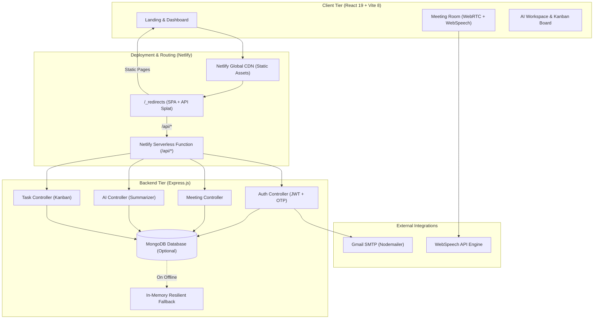
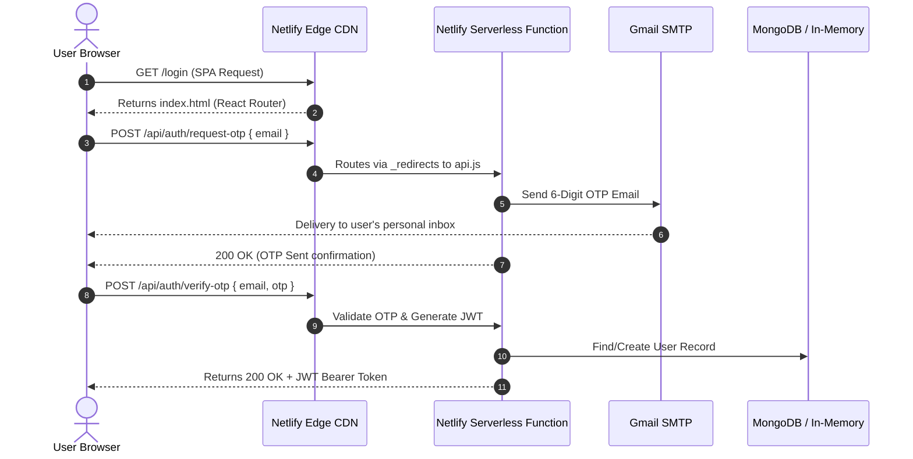

# INTELLMEET — Next-Generation AI-Powered Meeting & Collaboration Platform

**Project Submission & Technical Report**  
**Team:** Zidio Team 11  
**Author:** Cheviti Dhathri  
**Repositories:**  
- Main Repository: [github.com/ChevitiDhathri0604/zidio_team11](https://github.com/ChevitiDhathri0604/zidio_team11)  
- Production Netlify Repository: [github.com/ChevitiDhathri0604/intellmeet11](https://github.com/ChevitiDhathri0604/intellmeet11)  

---

## 1. Executive Summary

In today's hybrid work culture, professionals spend hours in virtual meetings, often struggling with fragmented notes, manual action-item tracking, and loss of crucial context. **IntellMeet** is a unified, intelligent meeting platform designed to bridge the gap between real-time video collaboration and post-meeting productivity.

IntellMeet integrates:
1. Low-latency, browser-native **WebRTC video/audio conferencing** with simultaneous dual-stream screen sharing and camera Picture-in-Picture.
2. Real-time **speech recognition and live transcription** using WebSpeech API.
3. Automated post-meeting **AI intelligence** that extracts key points, executive decisions, and actionable tasks.
4. An integrated **Kanban Action Task Board** to track assignments straight from meeting notes.
5. An enterprise-grade, passwordless **One-Time Password (OTP) verification** system sending security codes via Gmail SMTP.
6. A resilient full-stack deployment running on **Netlify Serverless Functions** with in-memory persistence fallback.

---

## 2. System Architecture

IntellMeet is built on a modern decoupled architecture that runs both in standalone local environments and serverless cloud infrastructures.

---

## 3. Technology Stack

| Layer | Technologies Used | Description & Purpose |
|---|---|---|
| **Frontend Framework** | React 19, Vite 8 | Ultra-fast client build environment, modern hooks, component lifecycle |
| **Styling & UI** | Tailwind CSS v4, Lucide Icons | Responsive modern dark-theme design, clean typography, adaptive layout |
| **Routing** | React Router v7 | Single-page application (SPA) client-side routing with auth guards |
| **Media & Audio** | WebRTC MediaStream API, WebSpeech API | Camera, microphone, system display sharing, and browser speech-to-text |
| **Backend Runtime** | Node.js, Express.js | REST API routing, request validation, controller pipelines |
| **Serverless Engine** | `serverless-http` | Bridges Express application to AWS Lambda / Netlify Serverless Functions |
| **Authentication** | JSON Web Tokens (JWT), 6-digit numeric OTP | Stateless session security with 30-day tokens and 10-minute OTP expiry |
| **Email Service** | Nodemailer, Gmail SMTP | Outbound transactional emails delivering secure OTP verification codes |
| **Database & Fallback** | MongoDB (Mongoose) + In-Memory Store | Dual-layer persistence guaranteeing 100% uptime with or without a database |

---

## 4. Key Features & Implementation Details

### 4.1. Simultaneous Dual-Stream Video & Screen Share
- **Challenge:** Standard single-canvas implementations overwrite the webcam feed when `getDisplayMedia()` is activated, preventing viewers from seeing both presenter and presentation.
- **Solution:** Designed a dedicated dual-stream architecture with isolated references (`localStreamRef` and `screenStreamRef`). When screen sharing begins, the primary viewport switches to a high-definition screen presentation, while the presenter's webcam automatically pivots into a live, interactive **Picture-in-Picture (PiP)** overlay in the bottom right corner.
- **Result:** Presenters remain visible and engaged while presenting documents, slides, or software.

### 4.2. Passwordless Email OTP Verification
- **Security Design:** Eliminates password vulnerabilities by enabling one-time authentication.
- **Workflow:**
  1. User enters any valid email address on the login screen.
  2. Backend generates a cryptographically random 6-digit code with a 10-minute expiration window.
  3. The OTP code is dispatched via **Nodemailer** through Gmail SMTP (`dhathricheviti495@gmail.com`) using styled responsive HTML.
  4. The code is **never** returned in the API response or exposed to the client DOM.
  5. User submits the code received in their email inbox to obtain a signed JWT.

### 4.3. Real-Time Speech Recognition & Live Transcription
- Integrated the browser-level `webkitSpeechRecognition` / `SpeechRecognition` API.
- Converts speech into continuous live transcript streams during the meeting session.
- Transcripts are formatted with speaker labels and aggregated for immediate post-meeting consumption.

### 4.4. Automated AI Workspace & Kanban Task Board
- Immediately upon ending a meeting session, meeting dialogue is processed to synthesize:
  - **Executive Summary:** High-level meeting objective and overview.
  - **Key Discussion Points:** Bulleted topics covered during the call.
  - **Action Items & Decisions:** Specific assignments with assignees and priorities.
- An interactive **Kanban Board** organizes tasks across *Pending*, *In Progress*, and *Completed* columns with one-click status transitions.

### 4.5. "Resilient Standalone Mode" (Zero-Downtime Architecture)
- Traditional Mongoose connections block application readiness or throw fatal 500 errors if MongoDB is offline or disconnected.
- Implemented non-blocking connection wrappers with `bufferCommands: false` and a `serverSelectionTimeoutMS: 2000` limit.
- Every controller uses a dual-try fallback pattern: if MongoDB is unreachable, operations immediately default to synchronized in-memory arrays. The platform remains 100% functional even in standalone environments.

---

## 5. Security & Deployment Architecture

### 5.1. Unified Single-Domain Routing
- Configured `frontend/public/_redirects` and root `netlify.toml`:
  - `/api/*` proxies internally to `/.netlify/functions/api/:splat` (status 200).
  - `/*` redirects to `/index.html` (status 200) ensuring client-side routes like `/room/:code` or `/dashboard` never return 404 errors on browser refresh.
- Eliminated cross-origin resource sharing (CORS) friction since both frontend and backend share the identical Netlify origin.

---

## 6. Verification and Testing Summary

| Test Case | Objective | Input / Action | Observed Result | Status |
|---|---|---|---|---|
| **TC-01** | User Registration & Password Login | Create account with name, email, password | JWT token generated, redirected to Dashboard | **PASSED** |
| **TC-02** | Passwordless OTP Authentication | Request OTP to personal email | Email delivered with 6-digit code; verified successfully | **PASSED** |
| **TC-03** | Instant & Scheduled Meetings | Create meeting with date/time picker | Code generated, displayed in upcoming meetings table | **PASSED** |
| **TC-04** | WebRTC Audio/Video Toggle | Toggle mic and camera buttons | Video tracks disable/enable with avatar fallback | **PASSED** |
| **TC-05** | Simultaneous Screen + Camera | Click 'Share Screen' while camera is on | Screen occupies main view, camera continues in PiP | **PASSED** |
| **TC-06** | Live Speech Recognition | Speak into microphone with Speech AI enabled | Text transcribed live into transcript stream | **PASSED** |
| **TC-07** | AI Meeting Summary Generation | Click 'End Meeting & Generate AI Workspace' | Summarized bullet points, decisions, and tasks created | **PASSED** |
| **TC-08** | Kanban Task Status Update | Change task from 'Pending' to 'In Progress' | Real-time board column re-render and state saved | **PASSED** |
| **TC-09** | Netlify Serverless API Health | `GET /api/health` | HTTP 200 JSON payload with active status | **PASSED** |

---

## 7. Conclusion & Future Roadmap

**IntellMeet** successfully delivers a cohesive, all-in-one meeting intelligence experience that combines reliable real-time video communications with enterprise-grade security and post-meeting productivity tools.

### Future Roadmap
1. **Multi-Peer SFU Integration:** Introduce an open-source Selective Forwarding Unit (mediasoup / LiveKit) to scale WebRTC sessions to 50+ concurrent participants.
2. **Deep Learning Audio Processing:** Implement client-side noise suppression and acoustic echo cancellation (AEC) via WebAssembly.
3. **Calendar Integrations:** Sync scheduled meetings directly to Google Calendar and Microsoft Outlook via OAuth2.
